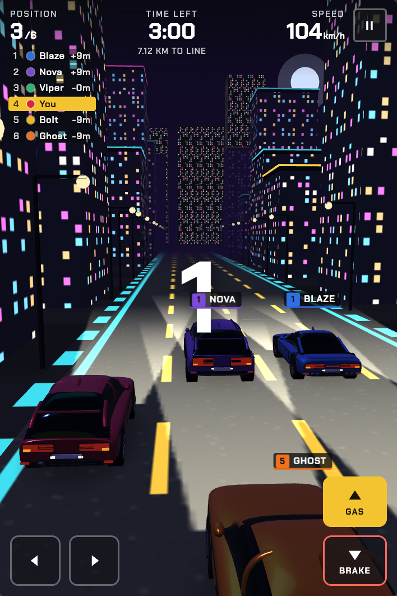
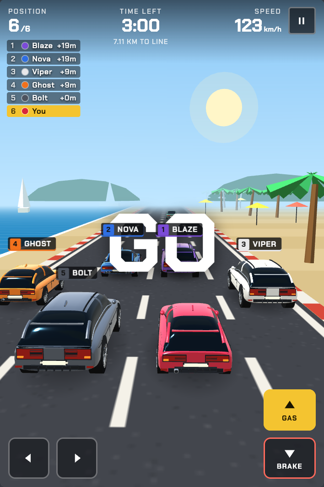
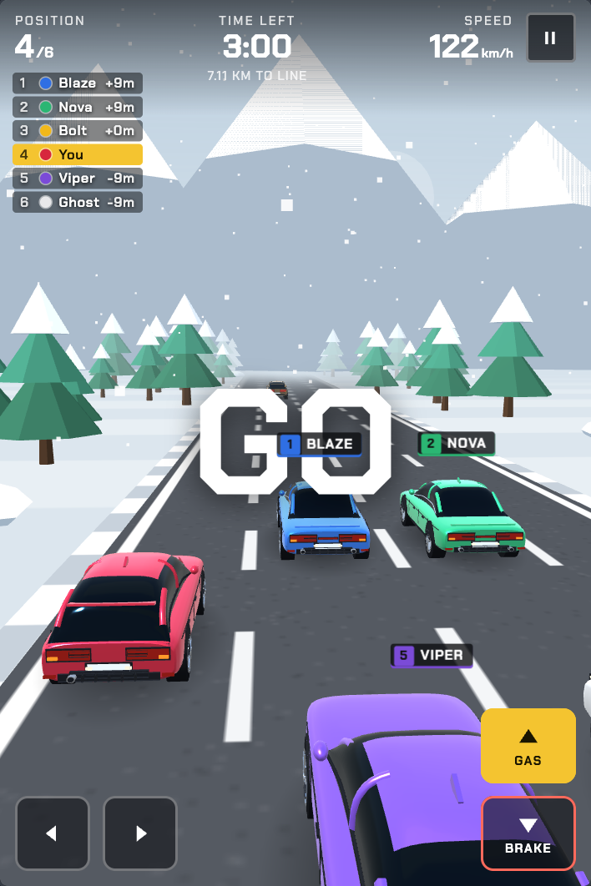
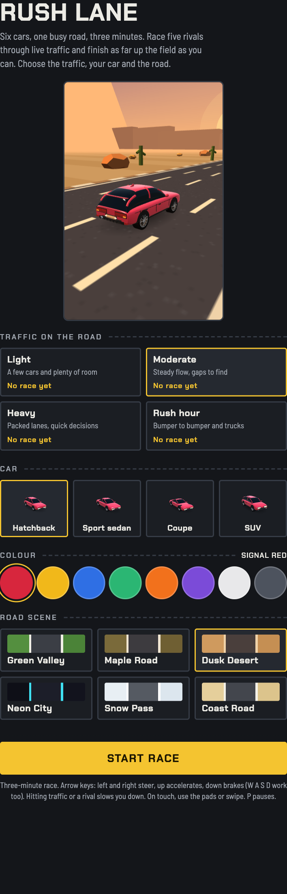
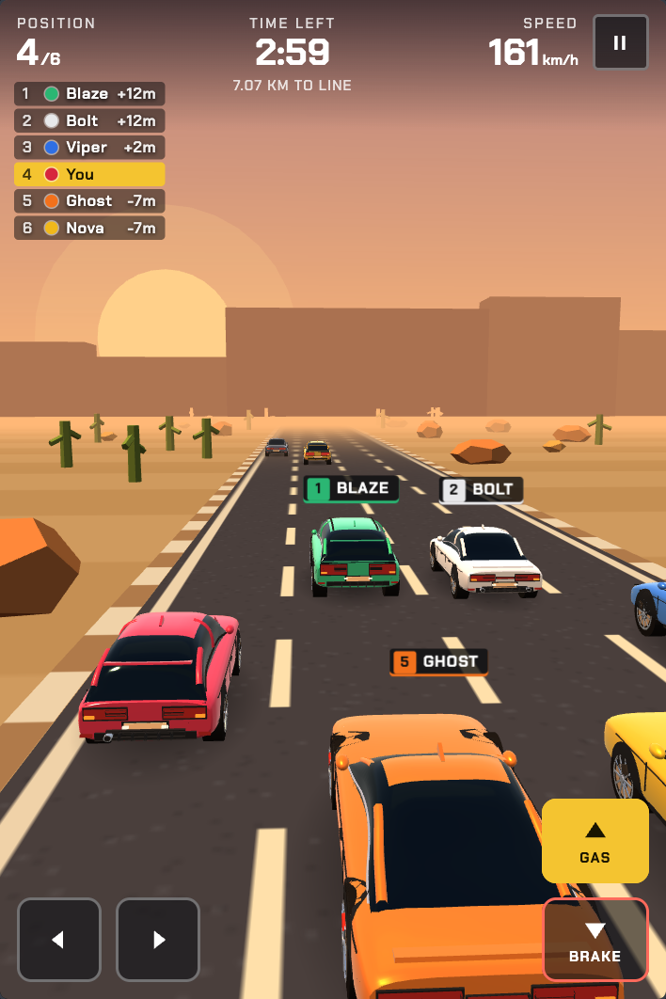

<div align="center">

# Rush Lane

**Rush Lane is a 3D browser racing game. Six cars, one busy road, three minutes.**

[**Play now: rush-lane.vercel.app**](https://rush-lane.vercel.app/)






</div>

## Overview

Race five rivals through live traffic and finish as high up the field as you can. Pick the traffic density, your car, its colour and the road scene, then go. The whole game is one self-contained file, `index.html`, with all vehicles and scenery generated procedurally in code (no image or model assets).

## Features

- **3D racing** on a 4-lane road with a live position board and distance-to-line readout
- **Six-car field**: you against five named rivals (Blaze, Viper, Nova, Bolt, Ghost)
- **4 traffic levels**, from Light to Rush hour with trucks
- **4 cars** and **8 colours**, rendered procedurally
- **6 road scenes**, including a night city and falling snow
- **Keyboard and touch** controls; responsive, mobile-friendly layout
- **Saved setup and best finishes** via `localStorage`
- Pause, restart and results screen with distance, crashes and top speed

## Quick start

**Play online:** [https://rush-lane.vercel.app/](https://rush-lane.vercel.app/)

Or run locally:

```sh
git clone git@github.com:symfonyaman/rush-lane.git && cd rush-lane
open index.html          # macOS; on Linux use xdg-open, or double-click the file
```

No build step, no dependencies to install.

**Requirements:** a WebGL-capable browser, and internet access on first load (Three.js r128 is fetched from cdnjs).

## Controls

| Action | Keyboard | Touch |
|---|---|---|
| Steer | `←` `→` or `A` `D` | On-screen pads, or swipe |
| Accelerate | `↑` or `W` | Gas pad |
| Brake | `↓` or `S` | Brake pad |
| Pause / resume | `P` or `Esc` | `II` button |

Hitting traffic or a rival slows you down and counts as a crash.

## Setup options



| Option | Choices |
|---|---|
| Traffic | Light, Moderate, Heavy, Rush hour |
| Car | Hatchback, Sport sedan, Coupe, SUV |
| Colour | Signal red, Racing yellow, Cobalt, Mint, Orange, Violet, Pearl, Graphite |
| Road scene | Green Valley, Maple Road, Dusk Desert, Neon City, Snow Pass, Coast Road |

Selections and best finishes per setup are stored under the `trafficRace.v1` key in `localStorage`.

<br clear="right">

## Road scenes

<table>
  <tr>
    <td align="center"><br><sub>Neon City</sub></td>
    <td align="center"><br><sub>Coast Road</sub></td>
    <td align="center"><br><sub>Snow Pass</sub></td>
    <td align="center"><br><sub>Dusk Desert</sub></td>
  </tr>
</table>

## Project structure

```
rush-lane/
├── index.html   # the entire game
├── docs/              # README screenshots
└── README.md
```

Inside `index.html`:

| Section | Purpose |
|---|---|
| Data | Constants plus `CARS`, `COLORS`, `LEVELS`, `SCENES` |
| 3D engine | Procedural cars and trucks, sky, ground, road, per-scene decor, snow |
| Game state | Player `P`, race state `G`, input, physics constants |
| Persistence | `persist()` and `bests` backed by `localStorage` |
| Input | Keyboard, touch pads and swipe handlers |

Game rules run in a flat 480×720 "pixel" space (`W`, `H`, `LW`); the 3D world maps it with `S` world units per pixel.

## Configuration

Edit constants near the top of `index.html`:

| What | Where |
|---|---|
| Race duration | `RACE_T` (seconds) |
| Race length | `LEVELS[level].len` |
| Traffic density, trucks, speed | `LEVELS[level]`: `interval`, `maxBlock`, `truck`, `start`, `top` |
| Handling | `ACC`, `BRK`, `MINV`, `STEER_K` |
| Scenery and colours | `SCENES`, `COLORS` |

To reset saved bests, clear the `trafficRace.v1` entry in your browser's local storage.

## Browser support

Any current browser with WebGL: Chrome, Edge, Firefox, Safari (desktop and mobile).

## Credits

Built with [Three.js](https://threejs.org/).
